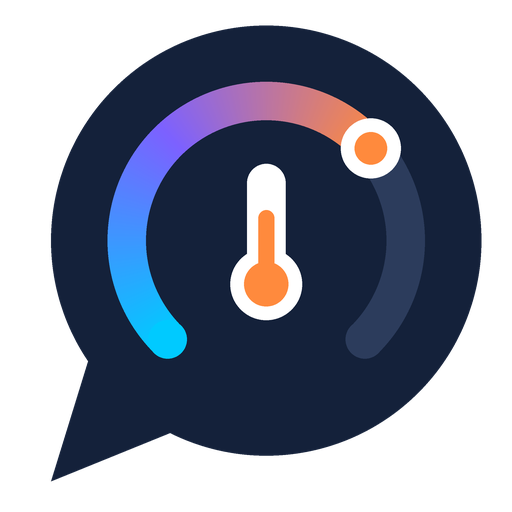

<p align="center">
  
</p>

<h1 align="center">Alexa Thermostat for Home Assistant</h1>

<p align="center">
  Control your <b>Amazon Smart Thermostat</b> from Home Assistant as a real climate entity.<br>
  No Homebridge, no bridges, no extra containers.
</p>

<p align="center">
  <a href="https://github.com/hacs/integration"></a>
  <a href="https://github.com/nikolmedo/AlexaThermostat/releases"></a>
  <a href="https://github.com/nikolmedo/AlexaThermostat/actions/workflows/validate.yml"></a>
  <a href="https://github.com/nikolmedo/AlexaThermostat/actions/workflows/tests.yml"></a>
  <a href="LICENSE"></a>
</p>

The Amazon Smart Thermostat only talks to Alexa. There is no local API, no Matter support and no
official Home Assistant integration, so until now the usual workaround was running Homebridge
with the `homebridge-alexa-smarthome` plugin and bridging it back into Home Assistant. That works
until it doesn't: when the plugin broke setpoint changes in 2026, there was nothing you could do
but wait.

This integration talks to the same Alexa web API directly from Home Assistant. You sign in once
with your Amazon account and your thermostat shows up as a native `climate` entity with the
standard thermostat card, automations, voice assistants and history.

## Features

- A native climate entity with the standard Home Assistant thermostat card.
- Heat, Cool, Heat/Cool (auto) and Off, plus an Eco preset.
- Target temperature in heat or cool mode, low and high setpoints in heat/cool mode.
- Current temperature and indoor humidity, as reported by the thermostat.
- Celsius and Fahrenheit. The integration uses the unit your thermostat reports and Home
  Assistant converts the rest.
- If Alexa rejects a command, Home Assistant tells you instead of
  silently snapping the value back.
- Your password is used once to sign in and is never stored. Only an
  Amazon refresh token is kept, like the Alexa app does.
- Multiple thermostats on the same account, each as its own device.
- A diagnostics download with secrets redacted, for painless bug reports.

## Requirements

- Home Assistant **2026.3** or newer.
- An Amazon Smart Thermostat (or another Alexa-connected thermostat) that you can control from
  the Alexa app.
- The Amazon account email and password linked to that Alexa app.

## Installation

### HACS (recommended)

[](https://my.home-assistant.io/redirect/hacs_repository/?owner=nikolmedo&repository=AlexaThermostat&category=integration)

1. Click the button above, or in HACS open the menu in the top right corner, choose
   **Custom repositories**, add `https://github.com/nikolmedo/AlexaThermostat` with the
   category **Integration**.
2. Search for **Alexa Thermostat** and download it.
3. Restart Home Assistant.

### Manual

1. Download the latest release.
2. Copy `custom_components/alexa_thermostat` into the `custom_components` folder of your Home
   Assistant configuration.
3. Restart Home Assistant.

## Setup

[](https://my.home-assistant.io/redirect/config_flow_start/?domain=alexa_thermostat)

1. Go to **Settings > Devices & services > Add integration** and pick **Alexa Thermostat**.
2. If you already use [Alexa Media Player](https://github.com/alandtse/alexa_media_player), choose
   **Use my Alexa Media Player sign-in**. That's the most reliable option: it reuses the Amazon
   session Alexa Media Player already has, so you don't type your password and Amazon has nothing
   to block.
3. Otherwise choose **Sign in with email and password** and enter your Amazon email, password and
   region (for example `amazon.com` or `amazon.co.uk`). If Amazon asks for a verification code or a
   captcha, the next screen will ask for it.

That's it. Each thermostat on your account becomes a device with one climate entity.

### Make sign-in painless with a 2FA app key (recommended)

Amazon often asks for a one-time code when a new device signs in. You can let Home Assistant
generate those codes for you:

1. On Amazon, open **Your Account > Login & security > 2-Step Verification**.
2. Add a new authenticator app and choose **Can't scan the barcode?**.
3. Copy the key Amazon shows (a long string of letters and digits, spaces are fine) and paste it
   in the **2FA app key** field during setup. Use the key, not a 6-digit code: a code typed there
   only works for that one sign-in.
4. Finish adding the app on Amazon with the code your phone app (or Home Assistant) shows.

You only need this once. After the first sign-in the integration keeps the session alive with a
refresh token.

## Options

Open the integration and click **Configure** to change the **update interval** (default 60
seconds, minimum 30). Lower values react faster but make more requests to Amazon.

## How it works

```
Home Assistant ──▶ climate entity ──▶ coordinator ──▶ Alexa GraphQL API (alexa.amazon.com)
                                                         ▲
                     Amazon sign-in (refresh token) ─────┘
```

The integration uses the same unofficial endpoint the Alexa web app uses
(`/nexus/v1/graphql`) to list your thermostats, read their state and send commands. Amazon login
is handled by [alexapy](https://pypi.org/project/alexapy/), the library behind Alexa Media
Player.

When you change something, the new value shows up right away. Alexa can take a few seconds to
report it back, so the integration keeps your value until Alexa catches up instead of flickering
back to the old one.

## Troubleshooting

**"Amazon rejected the email or password" or "Could not reach Amazon" with the right password.**
Amazon blocks some automated sign-ins and its sign-in pages change often. If you use Alexa Media
Player, pick **Use my Alexa Media Player sign-in** instead. Otherwise wait a few minutes before
retrying (Amazon throttles repeated attempts) and add the 2FA app key.

**"Amazon asked for a verification step this integration cannot show yet."**
Amazon sometimes wants you to approve the sign-in in the Amazon app or by email. Approve it and
try again. Adding a 2FA app key avoids most of these prompts.

**The integration asks me to sign in again.**
Amazon revoked the session (password change, too many devices, or a security check). Click
**Reconfigure** on the notification and enter your password again. Your thermostat keeps its
entity and history.

**A temperature change is rejected.**
You'll see the error Alexa returned. In heat/cool mode, set the low and high temperatures instead
of a single target.

**Something else.**
Enable debug logging from the integration page, reproduce the problem, and
[open an issue](https://github.com/nikolmedo/AlexaThermostat/issues/new/choose) with the
logs and the diagnostics file.

## Known limitations

- This uses an **unofficial** Amazon API. Amazon can change it at any time, and sign-in pages
  change more often than the thermostat API itself.
- State is polled (every 60 seconds by default). Changes made in the Alexa app show up on the
  next poll.
- The thermostat does not report whether it is currently heating or cooling, so there is no
  `hvac_action`.
- Captcha and app-approval sign-in steps are only partly supported (see Troubleshooting).

## Contributing

Pull requests are welcome. Start with [AGENTS.md](AGENTS.md): it explains the architecture, the
exact API payloads, the known gotchas and how to run the tests, for humans and AI assistants
alike.

## Credits

The Alexa API details come from the excellent
[homebridge-alexa-smarthome](https://github.com/joeyhage/homebridge-alexa-smarthome) by
@joeyhage, including the setpoint fix from its open pull request #285. Sign-in is powered by
[alexapy](https://gitlab.com/keatontaylor/alexapy).

## Disclaimer

This project is not affiliated with, endorsed by, or connected to Amazon. Amazon, Alexa and all
related marks are trademarks of Amazon.com, Inc. or its affiliates. Use at your own risk.
